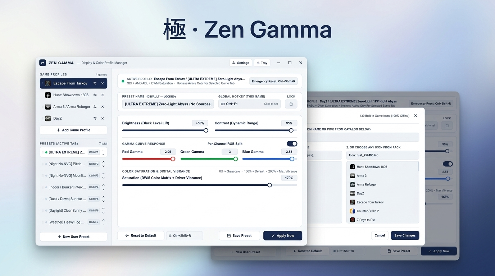
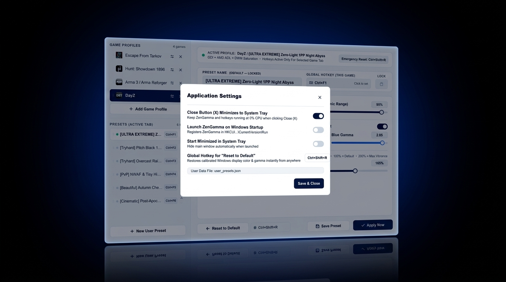

<div align="center">

  

  <br />
  <br />

  <h1>極 · Zen Gamma</h1>
  <p>
    <strong>Hardware LUT Calibration</strong> &nbsp;│&nbsp;
    <strong>Zero-Latency GPU Engine</strong> &nbsp;│&nbsp;
    <strong>Anti-Cheat Safe Architecture</strong>
  </p>

  <p>
    <em>The definitive hardware-calibrated color, gamma curve response, and digital vibrance utility for competitive tactical shooters.</em><br />
    <small>Engineered in pure native Rust with Win32 GDI ramp manipulation, AMD ADL / DWM saturation pipelines, active-tab hotkey isolation, and instant emergency rollback.</small>
  </p>

  <p>
    <a href="https://github.com/prfctcondition/zen-gamma/releases/latest"></a>
    
    
    
    
    <a href="LICENSE"></a>
  </p>

  <br />

  <p>
    <a href="https://github.com/prfctcondition/zen-gamma/releases/latest">
      
    </a>
  </p>

  <br />
</div>

---

## ✦ Why Zen Gamma?

> *Competitive tactical shooters like Escape from Tarkov, Hunt: Showdown 1896, DayZ, and Arma force players to fight in oppressive shadow environments where low-light visual acuity dictates the outcome of every engagement.*

**Zen Gamma was engineered from the ground up as a zero-overhead, hardware-level display calibration utility.**

Most players attempt to solve visibility issues through flawed workarounds:
1. **ReShade / Post-Processing Shaders**: Inject DLLs directly into the DirectX/Vulkan swapchain. This triggers instant anti-cheat kicks or permanent bans from BattlEye, Easy Anti-Cheat, and Ricochet, while degrading render pipeline frame times and introducing noticeable input latency.
2. **Monitor OSD Joystick Buttons**: Fumbling with physical hardware buttons in the heat of a firefight is slow, clunky, and limited to crude pre-programmed black equalizer presets that blow out highlight details.
3. **Driver Control Panels (NVIDIA Control Panel / AMD Adrenalin)**: Heavy, sluggish utilities with multi-second startup times that lack in-game global hotkeys, offer no per-game tab isolation, cannot execute independent per-channel RGB gamma splits on the fly, and offer no fail-safe emergency rollback.

Instead of intercepting game memory or hooking graphics APIs, **Zen Gamma communicates directly with the Windows kernel display subsystem**:
- Manipulates the hardware display controller's 256-entry 16-bit Look-Up Table (LUT) via Win32 GDI `SetDeviceGammaRamp`.
- Interfaces with the AMD ADL SDK (`ADL_Display_Color_Set`) and NVIDIA driver vibrance registers for hardware-accelerated saturation boost.
- Integrates DWM color matrix transforms for unified desktop and borderless windowed color enhancement.

**Zero DLL injection. Zero process memory access. 100% anti-cheat safe. Zero frame rate overhead.**

---

## ✧ Features & Architecture

### ▸ 01. Tri-Layer Display Calibration Pipeline
- **Win32 GDI Hardware LUT Ramp**: Generates high-precision `256 x 3` 16-bit gamma ramps with mathematical black-level lift (`Brightness`), dynamic range expansion (`Contrast`), and non-linear power-curve gamma correction.
- **Independent Per-Channel RGB Split**: Fine-tune Red, Green, and Blue gamma response curves independently. Counteract green NVG phosphor bloom in Tarkov, illuminate pitch-black foliage in DayZ, or isolate shadow silhouettes in Hunt: Showdown.
- **Universal Saturation & Digital Vibrance**: Combines AMD ADL driver-level saturation with Windows Desktop Window Manager (DWM) color matrix transformation for instant, vibrant target acquisition.

### ▸ 02. Active-Tab Isolated Global Hotkey Engine
- **Per-Game Hotkey Scoping**: Global hotkeys (`Ctrl+F1` through `Ctrl+F7`) are dynamically scoped to the currently active game profile.
- **Zero Collision Architecture**: Use identical hotkey combinations across different games without conflicts. Zen Gamma only listens to hotkeys for the game tab you currently have selected.
- **Asynchronous Registration**: Hotkeys are registered through low-overhead Win32 `RegisterHotKey` hooks running on a dedicated message-pump thread, ensuring instant response without polling loops.

### ▸ 03. Hardware-Calibrated Emergency Reset to Default
- **Instant Identity Ramp Restore**: Hit **`Ctrl+Shift+R`** (or your custom emergency hotkey) anywhere in Windows to instantly restore calibrated desktop colors (`gamma = 1.0`, `brightness = 0`, `contrast = 100%`).
- **Fail-Safe Crash Recovery**: Implements a native Rust `Drop` guard. If Zen Gamma is ever closed unexpectedly or terminated, the Windows hardware display ramp is guaranteed to reset to factory default.

### ▸ 04. Offline Game Catalog & Multi-Res Icon Pack
- **139 High-Definition Built-in Icons**: High-resolution 256x256 Steam and retail icons compiled directly into the binary with zero runtime external network requests.
- **Instant Searchable Profile Creator**: Easily search and add custom games from the offline catalog or enter custom game names with automatic icon mapping.
- **Pre-Configured Tactical Titles**: Out-of-the-box profiles for *Escape from Tarkov*, *Hunt: Showdown 1896*, *Arma 3 / Arma Reforger*, and *DayZ*.

### ▸ 05. Smooth Fluid Drag & Drop Reordering
- **Zero-Jitter Coordinate Decoupling**: Reorder game tabs and presets with smooth, fluid drag and drop. Decoupled mouse coordinates eliminate layout stutter and flickers during cursor drag operations.
- **State Persistence**: Reordered tabs and presets are serialized atomically into persistent JSON storage.

### ▸ 06. Background System Tray Daemon with 0% CPU Overhead
- **Native Slint Vector GUI**: Beautiful, high-DPI modern interface rendered via FemtoVG and Direct3D with sub-pixel text rendering.
- **Silent Tray Minimization**: Minimize to the Windows notification tray with one click. Hotkeys remain responsive in the background with zero CPU cycles consumed while idle.

---

<div align="center">
  
</div>

---

## ✦ Tactical Presets & Infinite Customization

> *Pre-configured for legendary tactical shooters — engineered for instant situational dominance.*

Zen Gamma comes out-of-the-box with fine-tuned presets tailored for hardcore environments in **Escape from Tarkov**, **DayZ**, **Hunt: Showdown 1896**, and **Arma 3 / Arma Reforger**:

- **Moonlit & Pitch-Black Night Piercing**: Elevates black levels and deep shadow floors to turn pitch-black darkness into clear, manageable twilight. Navigate dense forests, open fields, and pitch-black night servers without bulky NVGs—completely free of phosphor bloom, visual grain, and tunnel vision.
- **Underground Bunkers & Shadow Crypts**: Cuts through dense darkness, volumetric dust, and harsh contrast drop-offs inside underground complexes, catacombs, and unlit room corners.
- **Atmospheric Weather & Overcast Penetration**: Balances color depth to pierce heavy rain sheets, dense fog banks, and harsh sunrise glare, keeping enemy silhouettes sharply distinguished from the terrain.

---

### ✧ Sculpt Your Own Calibration Profiles

Every display panel, room lighting environment, and player preference is different. Zen Gamma offers complete, unconstrained control to shape your visual feed:

- **Create Unlimited Custom Presets**: Add bespoke presets to any game tab and assign dedicated global hotkeys (`Ctrl+F1`–`Ctrl+F12`) for instant mid-firefight switching.
- **Surgical Calibration Controls**:
  - **Black Level Lift (Brightness)**: Elevate compressed shadow tones without washing out midtones or blowing out highlights.
  - **Dynamic Range (Contrast)**: Sharpen silhouette edges and separate camouflaged player models from dense background foliage.
  - **Independent RGB Gamma Split**: Fine-tune Red, Green, and Blue gamma response curves discretely to counteract game-specific color tinting (e.g. heavy green hues or tinted night shaders).
  - **Digital Vibrance & Color Saturation**: Boost saturation up to **200%** via hardware DWM and driver pipelines for instantaneous peripheral target acquisition.
- **Fluid Drag & Drop Management**: Organize and prioritize games and presets effortlessly using smooth, zero-jitter drag-and-drop reordering.

---

## ✦ Architecture & Optimizer Comparison

| Technical Capability | **Zen Gamma** | ReShade / SweetFX | Monitor Physical OSD | GPU Driver Panels | Blind Batch Scripts |
| :--- | :---: | :---: | :---: | :---: | :---: |
| **Anti-Cheat Safe (Zero Ban Risk)** | **✔ 100% Safe (Kernel Display)** | ❌ Ban Risk (DLL Injection) | ✔ Safe (Hardware) | ✔ Safe (Driver) | ⚠ Variable |
| **Runtime Frame Rate Overhead** | **✔ 0.00% (Hardware LUT)** | ❌ 5–15% FPS Penalty | ✔ 0.00% | ✔ 0.00% | ✔ 0.00% |
| **Active-Tab Scoped Hotkeys** | **✔ Yes (Per-Game Tab Isolation)** | ❌ No | ❌ No (Physical Buttons) | ❌ No | ❌ No |
| **Per-Channel RGB Gamma Split** | **✔ Yes (Independent Curves)** | ✔ Yes (Shader-based) | ❌ Rare / Clumsy | ⚠ Basic | ❌ No |
| **Instant Emergency Rollback** | **✔ 1-Click (`Ctrl+Shift+R`)** | ❌ Manual Toggle | ❌ Navigate OSD Menu | ❌ Open Driver GUI | ❌ No (System Stuck) |
| **Process Crash LUT Recovery** | **✔ Native Rust Drop Guard** | ❌ May freeze shader | N/A | ⚠ Driver Dependent | ❌ Screws Windows LUT |
| **Built-in Offline Game Catalog** | **✔ 139 HD Titles & Icons** | ❌ None | ❌ None | ⚠ Auto-profiles only | ❌ None |
| **Idle Memory & CPU Consumption** | **✔ < 15 MB / 0% CPU** | ❌ Hooks Game Thread | 0 MB | ⚠ 150–400 MB Bloat | ❌ Terminal Windows |

---

## ✦ Installation

### Windows Installer (Recommended)
1. Download the latest installer from the [Releases page](https://github.com/prfctcondition/zen-gamma/releases/latest):
   - **`zen-gamma-setup.exe`** *(Official Setup Wizard — installs to local app data and creates Desktop & Start Menu shortcuts)*
   - **`zen-gamma.exe`** *(Standalone Portable Binary)*
2. Run **`zen-gamma-setup.exe`**, select your preferences, and launch **Zen Gamma**.
3. Choose your game profile, customize your tactical presets and hotkeys, and minimize to the system tray.

---

## ✦ Building From Source

### Prerequisites
- [Rust Toolchain](https://rustup.rs/) *(1.80+ stable, `x86_64-pc-windows-msvc`)*
- Windows 10 or Windows 11 SDK

### Setup & Compile
```powershell
# 1. Clone the repository
git clone https://github.com/prfctcondition/zen-gamma.git
cd zen-gamma

# 2. Run unit tests
cargo test

# 3. Build optimized production release binaries
cargo build --release

# 4. Built binaries are located in:
# .\target\release\zen-gamma.exe        (Main GUI Application)
# .\target\release\zen-gamma-setup.exe  (Setup Installer)
```

---

## ✦ Roadmap

- [x] **Direct Hardware GDI LUT Calibration**: 256-entry 16-bit gamma ramp synthesis with brightness lift and contrast scaling.
- [x] **Independent Per-Channel RGB Curve Split**: Discrete Red, Green, and Blue gamma response curves.
- [x] **AMD ADL & DWM Saturation Pipeline**: Digital vibrance and color matrix enhancement without game hooks.
- [x] **Active-Tab Isolated Hotkey Engine**: Game-scoped hotkeys with zero multi-game key collisions.
- [x] **1-Click Hardware Emergency Reset (`Ctrl+Shift+R`)**: Instant identity ramp restore with customizable hotkey.
- [x] **Offline Game Catalog & Multi-Res Icon Pack**: 139 high-definition 256x256 icons embedded directly into the binary.
- [x] **Smooth Drag & Drop Reordering**: Fluid zero-jitter game tab and preset reordering with atomic JSON persistence.
- [x] **System Tray Daemon**: Low-overhead background runner with 0% CPU consumption.
- [ ] **Multi-Monitor Display Selector**: Per-display independent hardware ramp binding for multi-monitor setups.
- [ ] **DirectX PresentMon Auto-Profile Hook**: Optional zero-injection foreground process detection to switch profiles automatically when entering target game windows.

---

## ✦ Support

Zen Gamma is 100% free, open-source, and built without subscriptions, advertisements, or background telemetry.

If Zen Gamma improved your target identification, saved your PMC in pitch-black night raids, or gave you an edge in competitive combat, support for the craft is received with quiet gratitude:

<p align="center">
  <a href="https://ko-fi.com/prfctcondition">
    
  </a>
  <br />
  <sub><a href="https://ko-fi.com/prfctcondition">ko-fi.com/prfctcondition</a></sub>
</p>

---

## ✦ Engineering & Philosophy

Zen Gamma is engineered as a zero-bloat, deterministic display systems utility written in native Rust (`slint` + `windows-rs`). Every gamma ramp transform, contrast stretch calculation, and display API call is executed with mathematical precision and protected by automatic hardware identity restore guards.

> *「 Clarity in darkness, precision in combat. 」*

---

## ✦ License

Distributed under the [MIT License](LICENSE). Crafted by **prfctCondition**.
